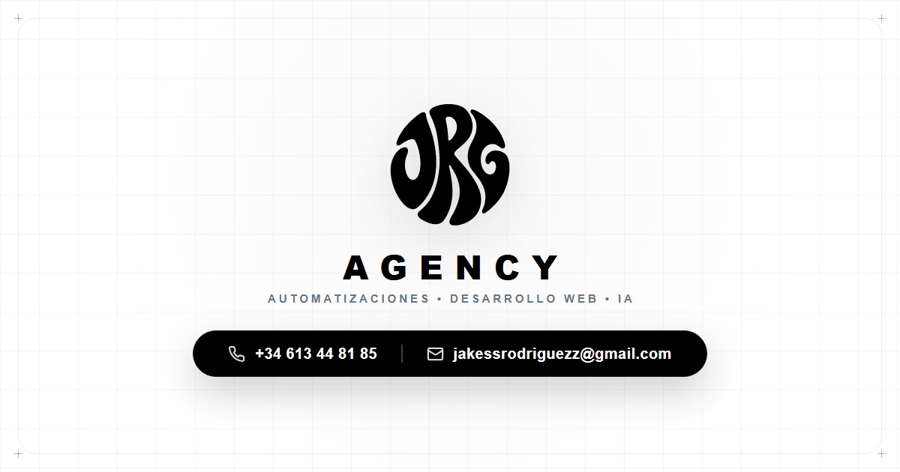

<p align="center">
  
</p>

<h1 align="center">✦ JRG AGENCY ✦</h1>

<p align="center">
  <strong>Agencia de Inteligencia Artificial • Desarrollo Web 3D • Automatización Empresarial</strong><br>
  <em>Estudio digital de alto impacto fundado en Urretxu, País Vasco, España.</em>
</p>

<p align="center">
  <a href="https://www.jrgagency.eus"></a>
  
  
  
  
  
  
  
</p>

---

## 🚀 Sobre JRG Agency

**JRG Agency** es un estudio tecnológico y creativo enfocado en el desarrollo de experiencias digitales de vanguardia. Fusionamos diseño visual cinematográfico, narrativa tridimensional interactiva (WebGL/Three.js) y sistemas avanzados de **inteligencia artificial y automatización de procesos** para empresas, pymes y negocios locales en España.

- 🌐 **Sitio Web Oficial:** [https://www.jrgagency.eus](https://www.jrgagency.eus)
- 📍 **Sede:** Urretxu, Gipuzkoa, País Vasco, España
- ⚡ **Rendimiento:** Arquitectura optimizada para métricas Core Web Vitals y Lighthouse 100/100.

---

## 🛠️ Servicios Principales

### 1. 🤖 Automatizaciones e Inteligencia Artificial
- Automatización integral de flujos de trabajo repetitivos y procesos de negocio.
- Integración de APIs, webhooks, bases de datos y CRMs.
- Chatbots conversacionales inteligentes para captación, reservas y soporte 24/7.

### 2. 🧊 Desarrollo Web 3D & Interfaces Inmersivas
- Experiencias tridimensionales interactivas en tiempo real impulsadas por **Three.js** y **React Three Fiber**.
- Animaciones fluidas basadas en scroll sincronizadas milimétricamente con **GSAP ScrollTrigger** y **Lenis**.
- Optimización de shaders y renderizado WebGL para compatibilidad total con dispositivos móviles.

### 3. 🎯 SEO Técnico & Arquitectura Digital
- Marcado semántico enriquecido con datos estructurados **Schema.org (JSON-LD)** para Google Search Console.
- Indexación avanzada con mapas del sitio XML (`sitemap.xml`), directivas de robots (`robots.txt`) y canonicalización.
- Tarjetas sociales **Open Graph** y **Twitter Cards** calibradas para previsualizaciones impecables en WhatsApp, Instagram, Telegram y Twitter/X.

---

## 📂 Portafolio de Proyectos Destacados

| Proyecto | Sector / Tipo | Stack Tecnológico | Enlace |
| :--- | :--- | :--- | :--- |
| **Gure Trena** | Hostelería & Restauración | React, Vite, Tailwind CSS, Local SEO | [guretrenaurretxu.com](https://guretrenaurretxu.com/) |
| **Urkulu Móviles** | Comercio & Soporte Técnico | React, TypeScript, Tailwind, WhatsApp API | [urkulumovilesurretxu.com](https://urkulumovilesurretxu.com/) |
| **Otxaran Denda** | Moda & Comercio Local | HTML5, Tailwind CSS, Catálogo Interactivo | [otxaran-denda.vercel.app](https://otxaran-denda.vercel.app/) |
| **JRG 3D Interactive Hub** | Experiencia WebGL 3D | Three.js, GSAP, WebGL, Lenis Scroll, TS | [jrgagency.eus](https://www.jrgagency.eus/) |
| **RedoxChess AI** | Motor Neuronal en Navegador | Web Workers, Minimax, Stockfish Engine | [jrgagency.eus/play](https://www.jrgagency.eus/play) |

---

## 🏗️ Stack Tecnológico Completo

```plaintext
Frontend Core:       React 18.3 • TypeScript 5.5 • Vite 5.4 • Tailwind CSS 3.4
3D & WebGL:          Three.js • @react-three/fiber • @react-three/drei • WebGL Shaders
Animación & Scroll:  GSAP (ScrollTrigger) • Lenis Smooth Scroll • Lucide Icons
Backend & Edge:      Edge Functions • EmailJS SDK • REST APIs
SEO & Social:        Open Graph 1200x630 • Schema.org JSON-LD • XML Sitemap • robots.txt
Deploy & CDN:        Vercel Edge Global Network • Cloudflare DNS
```

---

## 📁 Estructura del Proyecto

```plaintext
JRG-agency/
├── 1-Web/
│   └── 01_💻_Codigo_Web/          # Aplicación Web principal (React + TypeScript + Vite)
│       ├── public/                 # Assets públicos (sitemap.xml, robots.txt, og-image.jpg, 3D models)
│       └── src/
│           ├── components/         # Componentes UI, WebGL Three.js, Canvas y GSAP
│           ├── pages/              # Vistas de la aplicación (Home, MyWorks, Contact, Play, Demo)
│           ├── data/               # Modelos de datos y proyectos
│           └── utils/              # Animaciones, tipografía y motores de física/ajedrez
├── README.md                       # Documentación técnica principal
└── vercel.json                     # Configuración de despliegue en Vercel Edge
```

---

## 💻 Instalación y Desarrollo Local

### Requisitos previos
- **Node.js**: v18.0 o superior
- **npm** o **pnpm**

### 1. Clonar el repositorio
```bash
git clone https://github.com/jakesroodriguez/JRG-agency.git
cd JRG-agency
```

### 2. Entrar en la carpeta del código web
```bash
cd "1-Web/01_💻_Codigo_Web"
```

### 3. Instalar dependencias
```bash
npm install
```

### 4. Iniciar el entorno de desarrollo
```bash
npm run dev
```
Abre tu navegador en `http://localhost:5173/`.

### 5. Compilar para producción
```bash
npm run build
```
Los archivos optimizados y empaquetados se generarán en la carpeta `dist/`.

---

## 🔍 Google Search Console & SEO Ready

El repositorio incluye soporte nativo y automático para herramientas de rastreo:

- **Sitemap XML:** `https://www.jrgagency.eus/sitemap.xml`
- **Robots.txt:** `https://www.jrgagency.eus/robots.txt`
- **Open Graph Image:** `https://www.jrgagency.eus/og-image.jpg` (1200 × 630 px, ~66 KB)
- **JSON-LD:** Datos estructurados `Organization`, `ProfessionalService`, `LocalBusiness` y `WebSite`.

Para registrar la web en **Google Search Console**:
1. Accede a [Google Search Console](https://search.google.com/search-console).
2. Añade la propiedad `https://www.jrgagency.eus`.
3. En la sección **Sitemaps**, ingresa `sitemap.xml` y presiona **Enviar**.

---

## 📞 Contacto Directo

- 📍 **Ubicación:** Urretxu, Gipuzkoa, País Vasco, España
- ✉️ **Email:** [jakessrodriguezz@gmail.com](mailto:jakessrodriguezz@gmail.com)
- 📱 **WhatsApp / Teléfono:** [+34 613 44 81 85](https://wa.me/34613448185)
- 🐙 **GitHub:** [@jakesroodriguez](https://github.com/jakesroodriguez)
- 🌐 **Web:** [https://www.jrgagency.eus](https://www.jrgagency.eus)

---

<p align="center">
  <sub>© 2026 JRG Agency. Todos los derechos reservados. Diseñado y desarrollado con excelencia técnica.</sub>
</p>
